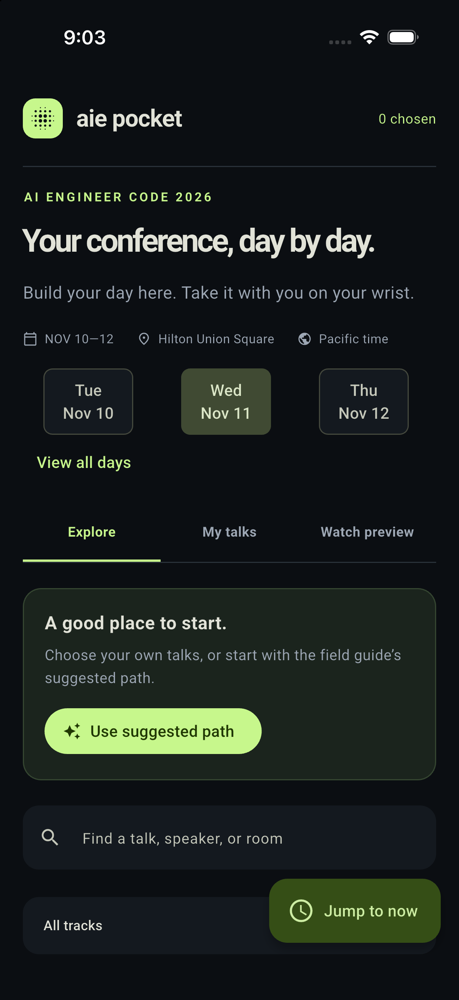
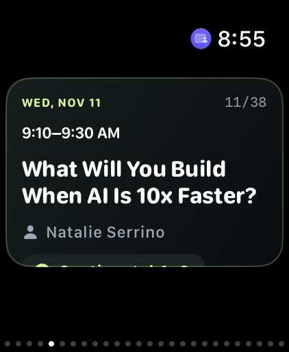

# AIE Pocket

[](https://github.com/EvanOman/aie-pocket/actions/workflows/ci.yml)

Choose conference talks on your iPhone, then swipe through their title, presenter, location, and time on Apple Watch. AIE Pocket pairs a Flutter companion with a native SwiftUI watch app and WidgetKit complications.

- Offline snapshot of 112 AI Engineer Code 2026 sessions, November 10–12, with an optional 37-session suggested path.
- Day tabs, search, topic filters, overlap warnings, and **Jump to now** for the current or next talk.
- Choices saved on the phone; chronological watch cards with scrolling for long titles and presenter lists.
- Circular and rectangular complications that open the schedule from a watch face.
- Complete WatchConnectivity snapshots, including an empty selection to clear the watch. A queued update is never described as delivered.

The catalogue is a fixed conference snapshot, not a live schedule. Times remain Pacific regardless of the device timezone. See [data provenance and limitations](docs/DATA.md).

## Screenshots

| iPhone companion | Apple Watch Ultra |
| --- | --- |
|  |  |

The phone image is a simulator capture; the watch image is a physical 49 mm Ultra capture. The purple watch status icon indicates Device Hub screen sharing.

## Build and try

Use Flutter **3.38.10** with Dart **3.10.9**. From the repository root:

```sh
flutter pub get
./scripts/check.sh
flutter run -d chrome
```

The browser runs the companion and a watch preview with browser-local choices. Actual watch synchronization requires the installed iPhone app. No application server or user account is required.

The check script enforces the Dart lockfile, checks formatting and strict analysis, runs behavior tests with coverage, and builds the web release. It also checks the Xcode project when the locked Ruby tools are available. See [testing and CI](docs/TESTING.md) for `just fc`, the separate `just fix` command, and the Flutter, Swift, and unsigned Apple build jobs. The static build in `build/web` uses `/` as its base path. Set `WEB_BASE_HREF=/aie-pocket/ ./scripts/check.sh` when deploying under that subpath.

For iPhone and watch builds, use a Mac with Xcode, CocoaPods, and Ruby `xcodeproj`: follow [build and installation](docs/BUILD.md). Flutter does not target watchOS; the native watch target is already included in the Xcode project.

## Project and validation

`lib/` contains the companion and browser watch preview, `ios/` the phone host and bridge, and `watch/` the native watch app, shared model, and complication.

Apple simulator builds and native swipe tests have passed. The companion and watch app have also been installed on physical devices, where a 38-talk schedule was received and rendered. Physical swipe, offline clearing, and complication behavior still need verification. See the [verification record](docs/VERIFICATION.md) for scope and limitations, and [Mac continuation notes](docs/MAC_HANDOFF.md) for the remaining checks.

## License

The original app code is available under the [MIT License](LICENSE). Bundled fonts and conference material have separate provenance and terms; see [third-party notices](THIRD_PARTY_NOTICES.md) and [data notes](docs/DATA.md).
